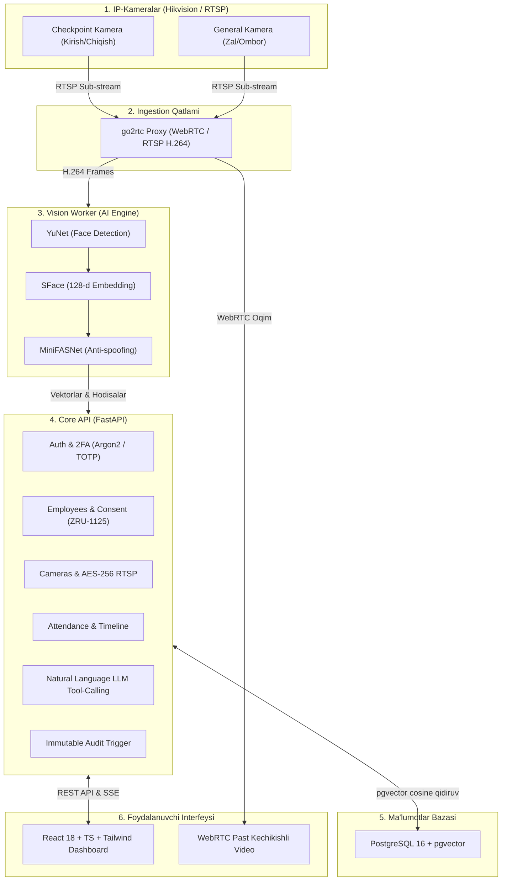

# 🏢 Workforce Vision Platform (WVP)
### Sun'iy Intellekt Asosidagi Xodimlar Davomati, Joylashuvi va Xavfsizligini Real Vaqtda Boshqarish Tizimi

[](https://www.typescriptlang.org/)
[](https://react.dev/)
[](https://fastapi.tiangolo.com/)
[](https://github.com/pgvector/pgvector)
[](https://opencv.org/)
[](https://github.com/AlexxIT/go2rtc)
[](#-8-litsenziyalar-va-ochiq-manbalar-auditi)
[](#-7-huquqiy-va-qonuniy-muvofiqlik-zru-1125-va-zru-1115)

---

## 📌 Mundarija
1. [Loyiha Haqida](#-1-loyiha-haqida)
2. [Tizim Arxitekturasi](#-2-tizim-arxitekturasi)
3. [Asosiy Funksional Imkoniyatlar](#-3-asosiy-funksional-imkoniyatlar)
4. [Loyiha Tuzilmasi (Monorepo)](#-4-loyiha-tuzilmasi-monorepo)
5. [Tezkor Ishga Tushirish (Quickstart)](#-5-tezkor-ishga-tushirish-quickstart)
   - [Frontendni Mahalliy Ishga Tushirish](#frontendni-mahalliy-ishga-tushirish)
   - [Docker orqali To'liq Tizimni Ishga Tushirish](#docker-orqali-toliq-tizimni-ishga-tushirish)
6. [API va Xizmatlar Ro'yxati](#-6-api-va-xizmatlar-royxati)
7. [Huquqiy va Qonuniy Muvofiqlik (ZRU-1125 va ZRU-1115)](#-7-huquqiy-va-qonuniy-muvofiqlik-zru-1125-va-zru-1115)
8. [Litsenziyalar va Ochiq Manbalar Auditi](#-8-litsenziyalar-va-ochiq-manbalar-auditi)
9. [Sifat va Aniqlik Mezonlari (KPI)](#-9-sifat-va-aniqlik-mezonlari-kpi)
10. [Kameralarni O'rnatish va Sozlash Qo'llanmasi](#-10-kameralarni-ornatish-va-sozlash-qollanmasi)
11. [Xavfsizlik Arxitekturasi](#-11-xavfsizlik-arxitekturasi)
12. [Ekspluatatsiya va Nosozliklarni Bartaraf Etish (Runbook)](#-12-ekspluatatsiya-va-nosozliklarni-bartaraf-etish-runbook)

---

## 📖 1. Loyiha Haqida

**Workforce Vision Platform (WVP)** — IP-kameralar (Hikvision, Dahua, ONVIF/RTSP) oqimini kompyuter ko'rishi (Computer Vision) va sun'iy intellekt orqali real vaqt rejimida tahlil qilib, korxona va tashkilotlarda (ofis, supermarket, restoran, ombor, fabrika):
- Xodimlar davomatini yuz orqali qayd etish (Face Check-in/Check-out);
- Ish zonalari va binolardagi mavjudligini uzluksiz monitoring qilish;
- Tanilmagan yuzlarni xavfsiz triaj qilish;
- Har bir harakat uchun vizual dalil (snapshot) taqdim etish;
- Tabiiy tilda xavfsiz savol-javob (`/ask`) interfeysi orqali tezkor hisobotlar olish imkonini beruvchi **On-Premise** platformadir.

---

## 🏗️ 2. Tizim Arxitekturasi

Platforma mikroservisli va monorepo tuzilishiga ega bo'lib, quyidagi qatlamlardan iborat:



---

## ✨ 3. Asosiy Funksional Imkoniyatlar

### 1. 🕒 Bugun (Today) & Interaktiv Kun Chizig'i (Timeline)
- **Real vaqt ko'rsatkichlari:** Ishda bo'lgan, ko'rinmayotgan va smenaga kelmagan xodimlar soni.
- **Smena va fakt taqqosi:** Rejalashtirilgan smena oralig'i bilan kamerada haqiqiy ko'ringan daqiqalar solishtiriladi.
- **Dalil oynasi (Evidence Modal):** Har bir qayd etilgan yuz uchun snapshot, kamera nomi, aniqlik ko'rsatkichi (confidence score) va menejer uchun *"To'g'ri / Noto'g'ri"* qayta aloqa tugmalari.

### 2. 🛡️ Xodimlar & Biometrik Rozilik Boshqaruvi
- **Qonuniy talab:** O'zbekiston Respublikasi Qonuni (ZRU-1125) talabiga asosan xodimning rasmiy roziligi olinmaguncha uning yuzini ro'yxatga olish (enrollment) bloklanadi.
- **Bir zumda bekor qilish (Right to Revoke):** Xodim roziligini bekor qilganda, uning barcha 128 o'lchamli yuz embeddinglari bazadan to'liq va qaytarib bo'lmaydigan qilib o'chiriladi.

### 3. 📹 Kameralar va Hikvision Integratsiyasi
- **Sub-oqim optimallashtirilgan:** AI tahlili tarmoqni yuklamaslik uchun H.264 sub-oqimda ishlaydi.
- **Jonli test ustasi (`/cameras/test`):** Kamera ulanishi, real FPS va tarmoq kechikishini (latency) bir zumda sinovdan o'tkazish.
- **Maxfiylik:** Kamera parollari va RTSP havolalari brauzerga berilmaydi, AES-256-GCM bilan shifrlanadi va go2rtc orqali qisqa muddatli tokenlar bilan WebRTC formatida uzatiladi.

### 4. 🏢 Bino 3D Fazoviy Modeli (Object Plan)
- Binoning izometrik 3D modeli, kameralarning koordinatalari va ularning ko'rish zonalari (FOV konuslari).
- Kameralarning onlayn/oflayn holatiga qarab vizual dinamik ko'rsatkichlar.

### 5. ❓ Tanilmagan Yuzlar Triaji (Unknown Faces)
- AI hech qachon shaxsni o'zboshimchalik bilan taxmin qilmaydi: ishonch chegarasidan past bo'lgan barcha yuzlar operator ko'rib chiqishi uchun ajratiladi (xodimga biriktirish, mehmon deb belgilash yoki e'tiborsiz qoldirish).

### 6. 💬 Tabiiy Tilda Savol-Javob Paneli (`/ask`)
- Menejer tabiiy tilda so'rov berishi mumkin (*"Bekzod bugun soat nechada keldi?"*, *"Hozir qaysi xodimlar ishda?"*).
- **Tool-calling arxitekturasi:** LLM bevosita SQL yozmaydi, faqat ruxsat etilgan xavfsiz Python funksiyalarini chaqiradi va faktlar asosida javob beradi.

### 7. 🔒 O'zgarmas Audit Jurnali (Immutable Audit Logs)
- PostgreSQL darajasida maxsus triggerlar orqali audit yozuvlarini `UPDATE` yoki `DELETE` qilish butunlay bloklangan.
- Faqat tizim egasi (Owner) tomonidan ko'rib chiqiladi.

---

## 📁 4. Loyiha Tuzilmasi (Monorepo)

```
vision-control/
├── core-api/                  # Python 3.12 + FastAPI async backend xizmati
│   ├── routers/               # auth, employees, cameras, attendance, unknown_faces, ask, stream, reports
│   ├── config.py              # Muhit o'zgaruvchilari va sozlamalar
│   ├── database.py            # Async SQLAlchemy session va connection pool
│   ├── models.py              # PostgreSQL jadvallari va pgvector(128) modellari
│   ├── schemas.py             # Pydantic v2 validatsiya sxemalari
│   ├── security.py            # Argon2 password hash, JWT token, AES-256-GCM shifrlash, TOTP
│   ├── Dockerfile             # Core API konteynerlashtirish
│   ├── requirements.txt       # Python bog'liqliklari
│   └── main.py                # FastAPI ilova kirish nuqtasi
│
├── vision/                    # Computer Vision AI Worker (oqim tahlil xizmati)
│   ├── face_engine.py         # OpenCV YuNet (detektor) + SFace (128-d tanish) [Apache 2.0]
│   ├── liveness.py            # MiniFASNet anti-spoofing tekshiruvi [Apache 2.0]
│   ├── worker.py              # RTSP kadr tahlili va Core API ga hodisa yuborish
│   ├── Dockerfile             # Vision Worker konteyneri
│   └── requirements.txt       # Vision kutubxonalari
│
├── ingestion/                 # Video oqim shlyuzi
│   └── go2rtc.yaml            # go2rtc RTSP & WebRTC konfiguratsiyasi
│
├── deploy/                    # Ishga tushirish va production paketlar
│   ├── docker-compose.yml     # postgres (pgvector), go2rtc, core-api, vision-worker, web
│   ├── init-db.sql            # PostgreSQL sxemasi va o'zgarmas audit triggerlari
│   ├── Dockerfile.frontend    # Nginx orqali frontend deploy qilish
│   └── .env.example           # Misol muhit o'zgaruvchilari
│
├── docs/                      # Tizim spetsifikatsiyalari va me'yoriy hujjatlar
│   ├── product.md             # Mahsulot spetsifikatsiyasi (SRS)
│   ├── legal.md               # O'zbekiston Qonunchiligi (ZRU-1125, ZRU-1115) muvofiqligi
│   ├── LICENSES.md            # Ochiq manbali litsenziyalar auditi (Apache 2.0 / MIT)
│   ├── kpi.md                 # Sifat va aniqlik mezonlari (TAR ≥ 98%, FAR ≤ 0.1%)
│   ├── camera-guide.md        # Hikvision kameralarni o'rnatish va sozlash yo'riqnomasi
│   └── runbook.md             # Tizim ekspluatatsiyasi va nosozliklarni yechish
│
├── src/                       # Frontend Web Dashboard (React 18 + TS + Tailwind CSS)
│   ├── pages/                 # Asosiy sahifalar (Today, Employees, Cameras, Object, Reports, etc.)
│   ├── components/            # UI komponentlar, CommandPalette, AskDrawer, Timeline, Badges
│   ├── contexts/              # Auth, Language va State boshqaruvi
│   ├── dev-mock/              # Mahalliy test va demo ma'lumotlar generatori
│   ├── hooks/                 # Custom React hooklar
│   ├── i18n/                  # Ko'p tillilik lug'atlari (O'zbek, Rus, Ingliz)
│   ├── lib/                   # Yordamchi utils va API klientlar
│   ├── types/                 # TypeScript type definitsiyalari
│   ├── App.tsx                # Marshrutlar va layout tizimi
│   └── main.tsx               # React boshlang'ich fayli
│
├── index.html                 # HTML shabloni
├── package.json               # Frontend bog'liqliklari
├── tailwind.config.js         # Tailwind ranglar palitrasi va uslublari
├── tsconfig.json              # TypeScript qoidalari
└── vite.config.ts             # Vite build sozlamalari
```

---

## 🚀 5. Tezkor Ishga Tushirish (Quickstart)

### Frontendni Mahalliy Ishga Tushirish

1. **Bog'liqliklarni o'rnatish:**
   ```bash
   npm install
   # Windows PowerShell'da xavfsizlik cheklovi bo'lsa:
   npm.cmd install
   ```

2. **TypeScript tekshiruvi:**
   ```bash
   npm run typecheck
   # yoki
   npm.cmd run typecheck
   ```

3. **Ishchi rejimda yoqish (Dev server):**
   ```bash
   npm run dev
   # yoki
   npm.cmd run dev
   ```
   Brauzerda oching: **`http://localhost:5173`**

4. **Production uchun yig'ish (Build):**
   ```bash
   npm run build
   # yoki
   npm.cmd run build
   ```

---

### Docker orqali To'liq Tizimni Ishga Tushirish

Butun infratuzilmani (PostgreSQL 16 pgvector, go2rtc, Core API, Vision Worker va Nginx Frontend) ishga tushirish:

1. **Muhit o'zgaruvchilarini sozlash:**
   ```bash
   cd deploy
   cp .env.example .env
   ```

2. **Konteynerlarni ishga tushirish:**
   ```bash
   docker compose up -d --build
   ```

3. **Xizmatlar portlari:**
   | Xizmat | Manzil | Vazifasi |
   |---|---|---|
   | **Web Dashboard** | `http://localhost:3000` | Asosiy veb-interfeys |
   | **Core API Docs** | `http://localhost:8000/docs` | FastAPI Swagger interaktiv hujjatlar |
   | **go2rtc Web UI** | `http://localhost:1984` | Video oqim shlyuzi boshqaruvi |
   | **PostgreSQL** | `localhost:5432` | pgvector qo'llab-quvvatlovchi baza |

4. **Konteynerlar holatini tekshirish:**
   ```bash
   docker compose ps
   docker compose logs -f api
   ```

---

## 📡 6. API va Xizmatlar Ro'yxati

Core API (`/api/v1`) quyidagi asosiy endpointlarni taqdim etadi:

| Bo'lim | Endpoint | Metod | Tavsif |
|---|---|---|---|
| **Auth** | `/auth/token` | `POST` | Tizimga kirish (JWT token olish) |
| **Auth** | `/auth/2fa/verify` | `POST` | TOTP 2-bosqichli tekshiruv |
| **Employees** | `/employees` | `GET` / `POST` | Xodimlar ro'yxati va yangi qo'shish |
| **Employees** | `/employees/{id}/consent` | `POST` | Biometrik rozilikni tasdiqlash |
| **Employees** | `/employees/{id}/revoke-consent`| `POST` | Rozilikni bekor qilish va embeddinglarni o'chirish |
| **Cameras** | `/cameras` | `GET` / `POST` | Kameralar ro'yxati va yangi kamera qo'shish |
| **Cameras** | `/cameras/test` | `POST` | RTSP oqimini jonli test qilish (FPS, latency) |
| **Attendance**| `/attendance/today` | `GET` | Bugungi kunlik davomat xulosasi |
| **Attendance**| `/attendance/timeline`| `GET` | Xodimning kunlik vaqt chizig'i |
| **Attendance**| `/attendance/events/{id}/feedback`| `POST`| Dalil fotosurati bo'yicha menejer qayta aloqasi |
| **Unknown** | `/unknown-faces` | `GET` | Tanilmagan yuzlar ro'yxati |
| **Unknown** | `/unknown-faces/{id}/link` | `POST` | Shaxsni xodimga biriktirish |
| **Ask** | `/ask` | `POST` | Tabiiy tildagi savolga tool-calling orqali javob |
| **Stream** | `/stream/token/{camera_id}` | `POST` | Kamera uchun xavfsiz WebRTC token olish |

---

## ⚖️ 7. Huquqiy va Qonuniy Muvofiqlik (ZRU-1125 va ZRU-1115)

Workforce Vision Platform O'zbekiston Respublikasi qonunlariga to'liq mos ravishda ishlab chiqilgan:

1. **Biometrik ma'lumotlarni mahalliylashtirish (ZRU-1125):**
   - O'zbekiston fuqarolarining biometrik va shaxsiy ma'lumotlari faqat **O'zbekiston hududida joylashgan serverlarda** saqlanadi.
   - Tashqi xorijiy bulut xizmatlariga (AWS, Google Cloud, Supabase va h.k.) biometrik embeddinglar va yuz tasvirlarini chiqarish qat'iyan man etiladi.
2. **Ixtiyoriy yozma rozilik talabi:**
   - Har bir xodimdan yuzni biometrik identifikatsiya qilishdan oldin yozma yoki elektron shaklda rozilik olinadi.
   - Xodim rozilikni istalgan paytda bekor qilishi mumkin; bekor qilinganda xodimning yuz embeddinglari bazadan bir zumda to'liq o'chiriladi.
3. **Sun'iy Intellekt tartibga solinishi (ZRU-1115):**
   - Sun'iy intellekt xodim haqida yakuniy jazolovchi qaror qabul qilmaydi, tizim faqat inson (menejer) uchun tekshiriladigan dalillar (evidence) taqdim etadi.
4. **Maxfiy hududlar daxlsizligi:**
   - Hojatxona, kiyinish xonalari, tibbiy xonalar va dam olish joylarida videokuzatuv o'rnatish taqiqlanadi.

---

## 📜 8. Litsenziyalar va Ochiq Manbalar Auditi

Loyiha to'liq tijoriy foydalanishga tayyor, ruxsat etilgan litsenziyalar asosida qurilgan:

| Komponent / Model | Vazifasi | Litsenziya | Holati |
|---|---|---|---|
| **OpenCV YuNet** | Yuzni aniqlash (Face Detection) | Apache 2.0 | ✅ Tasdiqlangan |
| **OpenCV SFace** | 128-d Yuz tanish embeddingi | Apache 2.0 | ✅ Tasdiqlangan |
| **MiniFASNet** | Anti-spoofing / Liveness tekshiruvi | Apache 2.0 | ✅ Tasdiqlangan |
| **FastAPI & SQLAlchemy** | REST API & Asinxron ORM | MIT | ✅ Tasdiqlangan |
| **PostgreSQL + pgvector** | RDBMS & Vektor indeksi | PostgreSQL / Apache 2.0 | ✅ Tasdiqlangan |
| **go2rtc** | RTSP / WebRTC oqim shlyuzi | MIT | ✅ Tasdiqlangan |
| **React, Vite, Tailwind CSS**| Veb interfeys va dizayn tizimi | MIT | ✅ Tasdiqlangan |

> [!CAUTION]
> **Taqiqlangan Modellar:**
> - **InsightFace rasmiy modellari (`buffalo_l`, `buffalo_s`):** Non-Commercial Research Only litsenziyasi bo'lgani sababli tijoriy yopiq kodda ishlatilmaydi.
> - **Ultralytics YOLO (v8, v9, v11) & BoxMOT:** AGPL-3.0 litsenziyasi butun loyiha kodini ochiq qilishni talab qilgani sababli ishlatilmaydi.

---

## 🎯 9. Sifat va Aniqlik Mezonlari (KPI)

| Mezon | Ko'rsatkich | Izoh |
|---|---|---|
| **Yuz bilan check-in aniqligi (TAR)** | **≥ 98%** | 20+ soatlik real oqim sinovida |
| **Noto'g'ri odamni qabul qilish (FAR)** | **≤ 0.1%** | 1:N qidiruvda begona shaxsni xodim deb tanimaslik |
| **Fotosurat bilan aldash (Liveness test)**| **≤ 1%** | MiniFASNet anti-spoofing himoyasi |
| **Ogohlantirish xatoligi (False Positive)**| **≤ 10%** | Menejer qayta aloqasi orqali tekshiriladi |
| **Hodisa xabarnomasining yetib borishi** | **< 5 soniya** | Vision Worker → Event Bus → SSE kechikishi |
| **Tabiiy tilda savol-javob tezligi** | **< 3 soniya** | `/ask` API javob vaqti |
| **Tizim ishonchliligi (Uptime)** | **≥ 99.5%** | 72 soatlik va 7 kunlik soak test sinovida |

---

## 🎥 10. Kameralarni O'rnatish va Sozlash Qo'llanmasi

### 1. Kamera turlari
- **Checkpoint (Kirish/Chiqish) Kameralari:**
  - **Balandlik:** 1.6 m – 2.0 m (ko'z darajasida, gorizontal og'ish ≤ 15°).
  - **Yoritish:** Kamida 300 lux, WDR (Wide Dynamic Range) yoqilgan bo'lishi lozim.
- **General (Zal/Umumiy) Kameralari:**
  - **Balandlik:** 2.8 m – 3.5 m (shiftda, hududiy qamrov uchun).

### 2. Hikvision Kameralarini Sozlash
- **RTSP Oqimlari:**
  - Asosiy oqim (klip arxivlash): `rtsp://<user>:<password>@<ip>:554/Streaming/Channels/101`
  - Sub-oqim (AI tahlili): `rtsp://<user>:<password>@<ip>:554/Streaming/Channels/102`
- **Kodek:** Sub-oqimda qat'iy **H.264**.
- **FPS:** Checkpoint uchun 25 FPS, umumiy zallar uchun 15 FPS.
- **Vaqt sinxronizatsiyasi:** Kamera vaqtini NTP server bilan sinxronlash (xatolik < 1s).

---

## 🔐 11. Xavfsizlik Arxitekturasi

- **Parollar:** Argon2id zamonaviy xeshlash algoritmi orqali saqlanadi.
- **2FA:** TOTP (Google Authenticator / Aegis) ikki bosqichli autentifikatsiya.
- **Kamera hisob ma'lumotlari:** AES-256-GCM yordamida shifrlanadi.
- **RBAC (Rollar tizimi):**
  - `Owner`: Tizim to'liq sozlamalari, o'zgarmas audit jurnali, barcha kameralar.
  - `Manager`: Xodimlar davomati, kun chizig'i, tanilmagan yuzlar triaji, savol-javob.
  - `Observer`: Cheklangan faqat ko'rish huquqi (biometrik snapshotlar yashirilgan).

---

## 🛠️ 12. Ekspluatatsiya va Nosozliklarni Bartaraf Etish (Runbook)

### Ma'lumotlar bazasini zaxiralash (Backup):
```bash
docker exec -t wfv-postgres pg_dump -U wfv_user wfv_db > backup_$(date +%Y%m%d).sql
```

### Zaxiradan tiklash (Restore):
```bash
cat backup_*.sql | docker exec -i wfv-postgres psql -U wfv_user -d wfv_db
```

### Xodim rozilikni qaytarganda biometrik embeddinglarni tekshirish:
```sql
SELECT count(*) FROM face_embeddings WHERE employee_id = '<xodim_uuid>';
-- Natija qat'iy 0 bo'lishi shart.
```

### go2rtc oqimini tekshirish:
```bash
docker compose logs -f go2rtc
```

---

<div align="center">
  <sub>Workforce Vision Platform © 2026. Barcha huquqlar himoyalangan.</sub>
</div>
# vision-control
